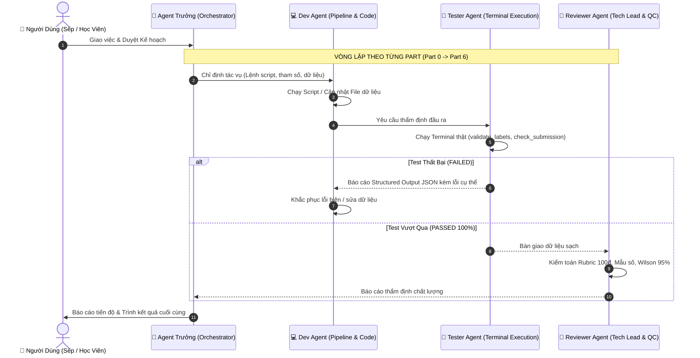
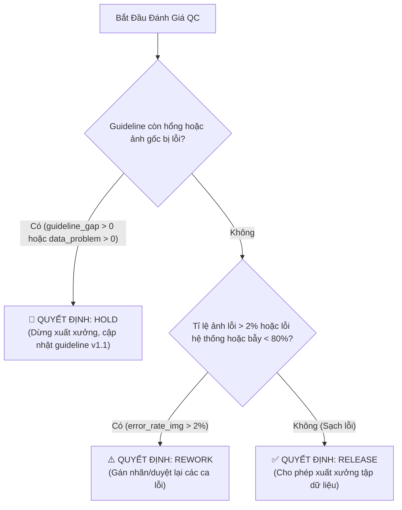

# HƯỚNG DẪN THỰC HIỆN CHI TIẾT BÀI LAB DAY 08
## AI Hỗ Trợ Gán Nhãn: Pre-label, Review, Calibration & QC
### Khóa K5-L23A — VinUni AI20k
**Học viên:** Lã Thái Hoà | **MSHV:** 2A202603069 | **GitHub:** Zeus-AIE  
**Cấu hình thực thi:** Windows 11 + PowerShell + GPU NVIDIA RTX 3060 Laptop (CUDA 12.1) + CVAT Docker Local (`http://localhost:8080`)

---

## 📑 MỤC LỤC
1. [Bản Chất Cốt Lõi & Bối Cảnh Dữ Liệu Phố Châu Á](#1-bản-chất-cốt-lõi--bối-cảnh-dữ-liệu-phố-châu-á)
2. [Mô Hình Vận Hành Đội Ngũ 3 Agent (Agent Dev Team)](#2-mô-hình-vận-hành-đội-ngũ-3-agent-agent-dev-team)
3. [Lộ Trình Triển Khai Chi Tiết Từng Part](#3-lộ-trình-triển-khai-chi-tiết-từng-part)
   - [Part 0: Thiết Lập Môi Trường, Trọng Số & Project CVAT](#part-0-thiết-lập-môi-trường-trọng-số--project-cvat-trước-buổi-học)
   - [Part 1: Gán Tay 4 Ảnh Gold Độc Lập (Không AI)](#part-1-gán-tay-4-ảnh-gold-độc-lập-không-ai-25-phút)
   - [Part 2: Khảo Sát Tour 3 Họ Mô Hình AI (YOLO26, YOLOE, SAM)](#part-2-khảo-sát-tour-3-họ-mô-hình-ai-yolo26-yoloe-sam-30-phút)
   - [Part 3: Tối Ưu Quét Ngưỡng Tin Cậy Theo Từng Lớp](#part-3-tối-ưu-quét-ngưỡng-tin-cậy-theo-từng-lớp-10-phút)
   - [Part 4: Gộp Pre-label, Cài 12 Bẫy & Duyệt Lô 24 Ảnh Batch](#part-4-gộp-pre-label-cài-12-bẫy--duyệt-lô-24-ảnh-batch-95-phút)
   - [Part 5: Tách Mask Pixel Bằng SAM Cho 3 Đối Tượng Phức Tạp](#part-5-tách-mask-pixel-bằng-sam-cho-3-đối-tượng-phức-tạp-15-phút)
   - [Part 6: Calibration Guideline v1.1, Kiểm Định QC & Chốt Release](#part-6-calibration-guideline-v11-kiểm-định-qc--chốt-release-45-phút)
4. [Kiểm Tra Nghiệm Thu & Nộp Bài (Checklist 100 Điểm)](#4-kiểm-tra-nghiệm-thu--nộp-bài-checklist-100-điểm)
5. [Cẩm Nang Xử Lý Sự Cố & Lỗi Thường Gặp Trên Windows](#5-cẩm-nang-xử-lý-sự-cố--lỗi-thường-gặp-trên-windows)

---

## 1. BẢN CHẤT CỐT LÕI & BỐI CẢNH DỮ LIỆU PHỐ CHÂU Á

### 1.1. Triết lý Human-in-the-Loop (HITL)
> *"Máy gán sẵn, người sửa. Nhanh hơn vẽ tay — nhưng BẠN vẫn là chốt chặn chất lượng, và bạn phải ĐO được điều đó."*

AI sinh nhãn nhanh gấp hàng chục lần con người nhưng mang những điểm mù hệ thống. Nếu tin tưởng hoàn toàn vào máy, mô hình mới huấn luyện sẽ học lại chính những sai lầm đó. Ngược lại, nếu vẽ tay toàn bộ từ đầu, chi phí gán nhãn cho các tập dữ liệu lớn là không khả thi. Giải pháp là quy trình phối hợp: **Mô hình AI tạo ứng viên ban đầu $\rightarrow$ Con người kiểm định và sửa lỗi có quy trình $\rightarrow$ Phân tích đo lường để hiệu chỉnh lại luật gán nhãn (Calibration).**

### 1.2. Đặc thù dữ liệu & Thất bại của mô hình chuẩn
- **Tập dữ liệu**: 36 bức ảnh đường phố Đông Nam Á (Hà Nội, TP.HCM, Bangkok) chia thành 3 tập:
  - `gold` (4 ảnh): Làm thước đo chuẩn tuyệt đối, gán tay hoàn toàn.
  - `batch` (24 ảnh): Lô dữ liệu chính cần gán nhãn pre-label + review + QC.
  - `pilot` (8 ảnh): Dùng thử nghiệm mô hình ở Part 2.
- **Vấn đề Three-wheeler**: Khoảng 28% ảnh xuất hiện phương tiện địa phương: **xe tuk-tuk, xích lô, xe ba gác máy, xe ba gác đạp**.
- **Thất bại của COCO Detector (YOLO26)**: Tập dữ liệu MS COCO chỉ có 80 lớp chuẩn. Khi gặp tuk-tuk hay ba gác, YOLO26 bị ép phân loại vào các lớp gần giống nhất: gọi tuk-tuk là `car`, gọi xe ba gác chở hàng là `truck`. Đổi ngưỡng tin cậy (`conf`) **không bao giờ sửa được lỗi này** vì đây là lỗi giới hạn ngữ nghĩa (Closed-set domain gap).
- **Vai trò của YOLOE**: Sử dụng kiến trúc Open-Vocabulary dựa trên CLIP text prompt (`--classes three_wheeler`) để nhận diện được tuk-tuk/ba gác, bù đắp lỗ hổng của YOLO26.
- **Vai trò của SAM (Segment Anything Model)**: Mô hình nền tảng phân đoạn ảnh không gán nhãn phân loại mà bóc tách mặt nạ pixel (`mask`) bám sát đường viền vật thể thông qua điểm click kích hoạt dương/âm.

### 1.3. Hiểm họa "Thiên kiến tự động hóa" (Automation Bias)
Khi khung chữ nhật của máy vẽ ra trông rất vuông vắn và hợp mắt, não bộ con người có phản xạ tự nhiên là lướt qua và bấm "Accept". Hậu quả:
- Bỏ sót các vật thể ở rìa ảnh hoặc bị che khuất một phần (lỗi `missing`).
- Không phát hiện các khung bao bị nới rộng nuốt cả phần nền đường/vỉa hè (lỗi `loose`).
- Bỏ qua các khung bao thừa vẽ vào biển quảng cáo hoặc bóng râm (lỗi `extra`).
- Không sửa lỗi sai lớp (lỗi `wrong_class`).

Để kiểm soát thiên kiến này, hệ thống sẽ bí mật tiêm **12 ảnh bẫy nhân tạo** vào tập batch 24 ảnh dựa trên MSHV `2A202603069`. Thước đo sống còn của người duyệt là **tỷ lệ bắt bẫy phải đạt $\ge 80\%$ ($\ge 10/12$ bẫy)**.

---

## 2. MÔ HÌNH VẬN HÀNH ĐỘI NGŨ 3 AGENT (AGENT DEV TEAM)

Nhằm tối đa hóa tính chuẩn xác, khách quan và tự động hóa theo chuẩn kỹ năng `agent-dev-team`, toàn bộ quy trình được phân rã cho 3 tác tử chuyên trách:



### Bảng Trách Nhiệm Ma Trận (RACI Matrix):
| Chức Năng | Dev Agent | Tester Agent | Reviewer Agent | Agent Trưởng |
|---|:---:|:---:|:---:|:---:|
| Chạy Pipeline (`scripts/*.py`) | **R** (Thực hiện) | **A** (Phê duyệt kỹ thuật) | **C** (Tư vấn) | **I** (Theo dõi) |
| Kiểm tra COCO Schema & Tên lớp | **C** | **R** (Chạy terminal) | **A** | **I** |
| Bảo vệ tập Gold sạch (Không AI) | **R** | **A** (Kiểm tra đối chiếu) | **R** (Audit) | **A** (Chịu trách nhiệm) |
| Bảo mật Khóa bẫy (`traps_key.json`)| **R** (Không mở trước) | **A** (Khóa truy cập) | **A** | **A** |
| Phân tích Thống kê & Mẫu số | **R** (Điền bảng) | **C** (Kiểm tra format) | **R** (Tính toán Wilson) | **A** |
| Cây quyết định Hold / Rework / Release | **C** | **I** | **R** (Đề xuất) | **A** (Chốt quyết định) |

---

## 3. LỘ TRÌNH TRIỂN KHAI CHI TIẾT TỪNG PART

### PART 0: Thiết Lập Môi Trường, Trọng Số & Project CVAT (Trước Buổi Học)

#### Mục tiêu:
Sẵn sàng toàn bộ công cụ, tải trọng số mô hình core, tạo Project CVAT với đúng 8 nhãn chuẩn và chuẩn hóa định danh học viên.

#### 1. Hành động của Dev Agent:
Chạy lệnh tải trọng số và chuẩn bị cấu trúc thư mục:
```powershell
# 1. Kích hoạt môi trường ảo (nếu chưa kích hoạt)
.venv\Scripts\Activate.ps1

# 2. Tải 3 trọng số cốt lõi (~0.35 GB: yolo26m.pt, yoloe-26s-seg.pt, sam2.1_b.pt)
python scripts/download_models.py --set core

# 3. Tải thêm MobileSAM để đối chứng ở Part 5 (~40 MB)
python scripts/download_models.py --set sam1

# 4. Sinh file nhãn JSON cho CVAT từ taxonomy.json
python scripts/make_cvat_labels.py

# 5. Phân chia thư mục ảnh cho các Task
python scripts/prepare_workdirs.py
```

Cập nhật thông tin định danh:
- File `STUDENT.md`: Điền Họ tên `Lã Thái Hoà`, MSHV `2A202603069`, Lớp `L23A`, GitHub `Zeus-AIE`, Repo URL `https://github.com/Zeus-AIE/K5-L23A-Day08-LaThaiHoa-2A202603069-AI-Assisted-Labeling.git`.
- File `README.md`: Dòng tiêu đề đổi thành `# Day 08 Lab — 2A202603069 - Lã Thái Hoà`.

#### 2. Thao tác trên giao diện CVAT Docker (`http://localhost:8080`):
1. Đăng nhập vào CVAT local.
2. Vào **Projects** $\rightarrow$ **Create a new project**:
   - Name: `day08-2A202603069`
3. Chuyển sang tab **Labels** $\rightarrow$ chọn tab con **Raw**:
   - Mở file `cvat/labels_generated.json` trên máy, copy toàn bộ nội dung JSON và dán đè vào khung soạn thảo Raw.
   - Bấm nút **Done** (hoặc **Save**).
4. Chuyển sang tab **Constructor** kiểm tra đủ 8 nhãn:
   - `person`, `bicycle`, `motorbike`, `car`, `bus`, `truck`, `three_wheeler`, `ignore_region`.
   - Mỗi nhãn phương tiện/người đều có 2 thuộc tính con: `conf` (text) và `can_review` (checkbox/boolean).
5. Bấm **Submit & Open**.

#### 3. Kiểm định của Tester Agent:
```powershell
python scripts/check_env.py --cvat http://localhost:8080
```
*Đầu ra chuẩn*: Toàn bộ các mục đạt `PASS` (Python, GPU CUDA RTX 3060, weights trong `models/`, CVAT trả lời 200). Trả về JSON:
```json
{"status": "PASSED", "step": "Part 0", "env_ready": true, "cvat_connected": true}
```

---

### PART 1: Gán Tay 4 Ảnh Gold Độc Lập (Không AI) (25 Phút)

#### Bản chất khoa học:
Tập Gold là "mỏ neo chân lý" (Ground Truth). Nếu xem nhãn do AI dự đoán trước khi vẽ, mắt bạn sẽ bị thiên kiến dẫn dắt và vô tình hợp thức hóa các sai lầm của AI. Khi đó, phép đo độ chính xác của AI ở các bước sau hoàn toàn mất giá trị.

#### 1. Thao tác trên CVAT:
1. Trong Project `day08-2A202603069`, bấm **+** tạo Task mới:
   - Name: `gold-manual`
   - Select files: Tải lên đúng **4 ảnh** trong thư mục `work/tasks/gold/` (`img_001.jpg`, `img_012.jpg`, `img_020.jpg`, `img_036.jpg`).
   - Bấm **Submit & Open**.
2. Mở Job gán nhãn:
   - Bắt đầu bấm đồng hồ đếm thời gian thực hiện.
   - Dùng phím tắt `N` (Rectangle) vẽ bounding box ôm sát từng đối tượng: `person`, `bicycle`, `motorbike`, `car`, `bus`, `truck`, `three_wheeler`.
   - **Quy tắc vàng**:
     - Box ôm sát mép nhìn thấy (sai số $\le 2\text{ px}$).
     - Người lái ngồi trên xe: vẽ 2 box riêng biệt đè lên nhau (1 `person` cho người, 1 `motorbike`/`bicycle` cho xe).
     - Vật bị che khuất $> 80\%$ (chỉ còn thấy $< 20\%$): Không gán.
     - Vật nhỏ $< 20\text{ px}$ chiều cao: Không vẽ từng chiếc. Cụm xe máy ở xa dày đặc $\rightarrow$ vẽ 1 khung `ignore_region` bao quanh cả cụm.
     - Ca phân vân quy tắc (ví dụ xích lô lai ba gác, người bán hàng dắt xe): Tick chọn `can_review = true` trong bảng thuộc tính bên phải.
   - Bấm `Ctrl + S` lưu sau mỗi ảnh.
3. Xuất kết quả:
   - Vào menu **Actions** $\rightarrow$ **Export task dataset**.
   - Export format: **COCO 1.0**.
   - Bỏ tích **Save images** (để file nhẹ, chỉ lấy JSON).
   - Bấm **OK**, chuyển sang trang **Requests**, chờ tiến trình đạt 100% rồi tải file `.zip` về.
   - Giải nén file `.zip`, lấy file `annotations/instances_default.json` và lưu đè vào:
     `submission/labels/gold_manual.json`.

#### 2. Hành động của Dev Agent:
Ghi nhận thời gian thực tế vào `submission/time_log.csv`:
```csv
step,images,minutes,note
gold_manual,4,22,gán tay 4 ảnh gold độc lập không AI
```

#### 3. Kiểm định của Tester Agent:
```powershell
python scripts/validate_labels.py submission/labels/gold_manual.json --expect gold
```
*Tiêu chí nghiệm thu*: Báo `OK`, đủ đúng 4 ảnh gold, không có nhãn lạ, không thiếu ảnh. Trả về JSON:
```json
{"status": "PASSED", "step": "Part 1", "file": "submission/labels/gold_manual.json", "images": 4, "errors": []}
```

---

### PART 2: Khảo Sát Tour 3 Họ Mô Hình AI (YOLO26, YOLOE, SAM) (30 Phút)

#### Bản chất khoa học:
Quan sát tận mắt ưu điểm và nhược điểm cố hữu của từng dòng mô hình trên tập 8 ảnh `pilot` (`img_002`, `007`, `011`, `015`, `016`, `019`, `030`, `032`).

#### 1. Hành động của Dev Agent:
Thực thi tuần tự các lệnh thử nghiệm trên terminal:
```powershell
# Lượt 1: YOLO26m conf 0.25 (mặc định) trên pilot
python scripts/prelabel.py --model yolo26 --size m --split pilot --conf 0.25 --out work/prelabel/t_y26

# Lượt 2: YOLO26m nâng conf lên 0.5 (kiểm tra hiện tượng mất vật nhỏ)
python scripts/prelabel.py --model yolo26 --size m --split pilot --conf 0.5 --out work/prelabel/t_y26_c05

# Lượt 3: YOLOE-26s open-vocabulary tìm riêng three_wheeler
python scripts/prelabel.py --model yoloe --classes three_wheeler --split pilot --conf 0.25 --out work/prelabel/t_yoloe

# Lượt 4: YOLO26m kết hợp SAM 2.1 tạo mask đa giác trên 2 ảnh
python scripts/prelabel.py --model yolo26 --size m --classes "person,motorbike,car" --images img_004.jpg img_013.jpg --conf 0.3 --segmenter sam --sam sam2.1_b.pt --out work/prelabel/t_sam

# Chạy cache nền toàn bộ 36 ảnh ở conf đáy 0.05 (chuẩn bị cho Part 3 & 4)
python scripts/prelabel.py --model yolo26 --size m --split all --conf 0.05 --out work/prelabel/y26_all --no-viz
python scripts/prelabel.py --model yoloe --classes three_wheeler --split all --conf 0.05 --out work/prelabel/yoloe_all --no-viz
```

#### 2. Ghi nhận phân tích vào `submission/model_log.csv`:
Mở các ảnh trong các thư mục `viz/` tương ứng để quan sát và điền tối thiểu 4 dòng vào `submission/model_log.csv`:
- **Dòng 1 (YOLO26m conf 0.25)**: `what_went_right`: Bắt người, xe máy, ô tô rất nhạy; `what_went_wrong`: Trên `img_002.jpg` gọi xe tuk-tuk xanh tiền cảnh thành `car` (0.84); `decision`: Giữ lại làm detector nền cho 6 lớp COCO chuẩn.
- **Dòng 2 (YOLO26m conf 0.5)**: `what_went_right`: Khung bao nền xa rất sạch, không box rác; `what_went_wrong`: Trên `img_011.jpg` bỏ sót hơn 3 xe máy nhỏ ở xa; `decision`: Không dùng ngưỡng 0.5 chung cho mọi lớp.
- **Dòng 3 (YOLOE-26s)**: `what_went_right`: Nhận diện chuẩn xác chiếc tuk-tuk trên `img_002.jpg` (conf 0.93) và xích lô; `what_went_wrong`: Box bao hơi lỏng, đôi khi bắt nhầm xe bán tải; `decision`: Dùng YOLOE ưu tiên đè lên YOLO26 cho lớp `three_wheeler`.
- **Dòng 4 (YOLO26m + SAM 2.1)**: `what_went_right`: Mask đa giác bám rất sát viền kim loại và bánh xe; `what_went_wrong`: Trên `img_013.jpg` mask xe tuk-tuk nuốt trọn cả người lái do box YOLO26 bao trùm cả hai; `decision`: Phải dùng point prompt âm (`--neg`) để bóc tách người lái.

#### 3. Kiểm định của Tester Agent:
Kiểm tra tính đầy đủ của file log:
```powershell
python -c "import pandas as pd; df = pd.read_csv('submission/model_log.csv'); assert len(df) >= 4; print('Model log rows:', len(df))"
```

---

### PART 3: Tối Ưu Quét Ngưỡng Tin Cậy Theo Từng Lớp (10 Phút)

#### Bản chất khoa học:
Mỗi loại phương tiện có kích thước, tần suất và đặc trưng hình học khác nhau. Áp dụng một ngưỡng cào bằng (ví dụ `0.3`) sẽ làm hỏng dữ liệu: lớp đông đúc như `motorbike` bị sinh nhiều box giả, còn lớp dễ biến dạng như `person` bị bỏ sót. Ta cần quét tìm ngưỡng tối ưu cho từng lớp sao cho **Recall trên Gold đạt tối thiểu 90%** (khống chế trần $\le 0.5$).

#### 1. Hành động của Dev Agent:
Chạy công cụ quét ngưỡng đối chiếu giữa 2 nguồn cache conf 0.05 và nhãn Gold:
```powershell
python scripts/threshold_sweep.py `
  --pred work/prelabel/y26_all/pre.coco.json work/prelabel/yoloe_all/pre.coco.json `
  --gold submission/labels/gold_manual.json
```

#### 2. Đọc kết quả trong `submission/qc/threshold_sweep.md`:
- Xem bảng chi tiết:
  - Lớp `person`: Ngưỡng khuyến nghị (thường khoảng `0.30` - `0.35`).
  - Lớp `motorbike`: Ngưỡng khuyến nghị (thường khoảng `0.45` - `0.50`).
  - Lớp `car`: Ngưỡng khuyến nghị (thường khoảng `0.35` - `0.40`).
  - Các lớp ít mẫu ($< 5$ đối tượng trên 4 ảnh Gold như `bus`, `truck`, `bicycle`, `three_wheeler`): Script tự động giữ ngưỡng mặc định `0.3`.
- **Sao chép chuỗi tham số `--thr`** ở dòng cuối cùng của báo cáo (ví dụ: `--thr "person=0.35,motorbike=0.5,car=0.35"`).

#### 3. Kiểm toán của Reviewer Agent:
- Ghi nhận vào mục 1 của `REPORT.md`: Phân tích rõ việc quét ngưỡng trên chính 4 ảnh Gold là phép đo **in-sample** mang tính chất lạc quan. Không được ép tăng ngưỡng của các lớp ít mẫu.

---

### PART 4: Gộp Pre-label, Cài 12 Bẫy & Duyệt Lô 24 Ảnh Batch (95 Phút)

#### Bản chất khoa học:
Gộp nhãn máy theo thứ tự ưu tiên: YOLOE đứng trước YOLO26 (để `three_wheeler` đè `car`/`truck` với IoU $\ge 0.6$). Sau đó tiêm 12 bẫy nhân tạo theo MSHV `2A202603069` để thử thách độ tỉnh táo của người duyệt trên CVAT.

#### 1. Hành động của Dev Agent:
```powershell
# 1. Gộp pre-label với chuỗi ngưỡng tối ưu từ Part 3
python scripts/merge_prelabels.py `
  work/prelabel/yoloe_all/pre.coco.json `
  work/prelabel/y26_all/pre.coco.json `
  --thr "person=0.35,motorbike=0.5,car=0.35" `
  --conf 0.3 --iou 0.6 --split "batch,gold" `
  --out work/prelabel/merged_review/pre.coco.json

# 2. Cài 12 bẫy nhân tạo theo MSHV (LƯU Ý: Luôn bọc nháy kép MSHV)
python scripts/inject_traps.py `
  --pre work/prelabel/merged_review/pre.coco.json `
  --student "2A202603069"
```
*Lưu ý bảo mật*: Tuyệt đối **KHÔNG MỞ** file `submission/prelabel/traps_key.json` trước khi hoàn tất duyệt và export nhãn!

#### 2. Thao tác nạp và duyệt nhãn trên CVAT:
1. Tạo Task mới tên `batch-review` trong Project `day08-2A202603069`:
   - Select files: Tải lên toàn bộ **24 ảnh** trong thư mục `work/tasks/review/`.
   - Bấm **Submit & Open**.
2. Nạp Pre-label có bẫy vào Task:
   - Vào menu **Actions** $\rightarrow$ **Upload annotations**.
   - Import format: **COCO 1.0**.
   - Chọn tệp: `submission/prelabel/pre_traps_import.coco.json` (**CHÚ Ý**: Không chọn nhầm `pre_traps.coco.json`).
   - Import mode: **Replace** $\rightarrow$ Bấm **OK**.
   - Khi hộp thoại xác nhận hiện ra, bấm tiếp nút **Replace annotations** (nếu không bấm, Task sẽ có 0 shape).
3. Mở Job và thực hiện duyệt 24 ảnh theo **Quy trình 4 bước chống thiên kiến**:
   - **Bước 1 (Quét toàn cảnh)**: Bấm vào biểu tượng con mắt trên cùng bảng *Objects* bên phải để ẩn toàn bộ nhãn máy. Dùng mắt quét từ trái sang phải, đếm nhẩm các cụm người và xe.
   - **Bước 2 (Bắt lỗi thiếu & thừa)**: Bật lại mắt hiển thị nhãn máy. Nếu thấy người/xe chưa có khung bao $\rightarrow$ bấm phím `N` vẽ bổ sung ngay (bắt bẫy `missing`). Nếu thấy khung bao rác vẽ vào vỉa hè, biển hiệu $\rightarrow$ bấm phím `Del` xóa ngay (bắt bẫy `extra`).
   - **Bước 3 (Sửa sai lớp & Kéo khít viền)**: Nhìn từng chiếc xe tuk-tuk: nếu máy gán `car` hay `truck` $\rightarrow$ đổi ngay thành `three_wheeler` (bắt bẫy `wrong_class`). Rà 4 cạnh hộp: nếu hộp bị nới rộng hở nền $\rightarrow$ kéo các cạnh bám khít biên xe (bắt bẫy `loose`). Nếu có 2 box chồng lên nhau cùng 1 xe $\rightarrow$ xóa bớt 1 box.
   - **Bước 4 (Lọc & Đánh dấu ca khó)**: Dùng tính năng **Filters** trên top bar lọc xem từng lớp. Với ca phân vân hoặc bị che khuất khó xác định, tick chọn `can_review = true`.
   - *Lưu ý với 6 ảnh xe máy dày đặc (`img_005`, `018`, `021`, `024`, `028`, `029`)*: Cụm xe nhỏ phía xa $< 20\text{ px}$ gom bằng 1 khung `ignore_region`, không vẽ lẻ tẻ từng chiếc.
   - Bấm `Ctrl + S` lưu sau mỗi ảnh. Bấm đồng hồ ghi tổng thời gian duyệt vào `submission/time_log.csv`.
4. Xuất nhãn sau duyệt:
   - **Actions** $\rightarrow$ **Export task dataset** $\rightarrow$ Format: **COCO 1.0** $\rightarrow$ Bỏ tích Save images $\rightarrow$ Bấm **OK**.
   - Tải file `.zip` từ mục Requests, giải nén lấy `annotations/instances_default.json` lưu đè vào:
     `submission/labels/batch_reviewed.json`.

#### 3. Tính toán thống kê & AI Error Profile:
```powershell
python scripts/validate_labels.py --all

python scripts/review_stats.py `
  --pre submission/prelabel/pre_traps.coco.json `
  --final submission/labels/batch_reviewed.json `
  --gold submission/labels/gold_manual.json `
  --key submission/prelabel/traps_key.json
```

#### 4. Tiêu chí nghiệm thu của Tester & Reviewer Agent:
- Tỷ lệ bắt bẫy in trong `submission/qc/review_stats.md` phải đạt **$\ge 80\%$ ($\ge 10/12$ bẫy)**.
- Đọc bảng AI error profile:
  - `accepted`: Số box máy giữ nguyên (mẫu số: tổng box máy).
  - `edited`: Số box máy được sửa lớp hoặc chỉnh tọa độ.
  - `deleted`: Số box máy bị xóa bỏ do sai/thừa.
  - `added`: Số đối tượng người duyệt tự vẽ thêm do máy bỏ sót.
- Trả về JSON xác nhận của Tester:
  ```json
  {"status": "PASSED", "step": "Part 4", "trap_catch_rate": "11/12 (91.7%)", "labels_valid": true}
  ```

---

### PART 5: Tách Mask Pixel Bằng SAM Cho 3 Đối Tượng Phức Tạp (15 Phút)

#### Bản chất khoa học:
Bounding box chữ nhật bất lực trước các vật thể có cấu trúc rỗng (xe tuk-tuk có mui hở, xích lô có khung kim loại). Mask phân đoạn mức pixel giải quyết triệt để vấn đề này. Tuy nhiên, một click đơn lẻ có thể mang nhiều nghĩa (bộ phận, toàn xe, hay cả người ngồi trên xe). Theo quy tắc mục 4.2 của Guideline: **Mask của phương tiện chỉ bao trùm khung xe, bánh xe, mui xe; người lái (`person`) và hàng hóa nhô ra ngoài phải bị loại trừ bằng điểm click âm (`--neg`)**.

#### 1. Hành động của Dev Agent:
Chạy trích xuất mask bằng SAM 2.1 kết hợp so sánh với MobileSAM:
```powershell
# Vật 1: Xe tuk-tuk trên img_013.jpg (SAM 2.1 base)
# Tọa độ: pos trên thân và mái xe; neg trên lưng áo người lái
python scripts/sam2_points.py --image img_013.jpg `
  --pos "400,480" --pos "600,110" --neg "720,300" `
  --sam sam2.1_b.pt --out submission/masks --name tuktuk_img013_sam2

# Đối chứng Vật 1 với MobileSAM trên cùng tọa độ click
python scripts/sam2_points.py --image img_013.jpg `
  --pos "400,480" --pos "600,110" --neg "720,300" `
  --sam mobile_sam.pt --out submission/masks --name tuktuk_img013_sam1

# Vật 2: Xe tuk-tuk trên img_004.jpg
python scripts/sam2_points.py --image img_004.jpg `
  --pos "620,480" --pos "700,560" --neg "465,450" `
  --sam sam2.1_b.pt --out submission/masks --name tuktuk_img004_sam2

# Vật 3: Xe ba gác/xích lô trên img_017.jpg
python scripts/sam2_points.py --image img_017.jpg `
  --pos "560,420" --pos "680,500" --neg "645,355" `
  --sam sam2.1_b.pt --out submission/masks --name tuktuk_img017_sam2
```

#### 2. Đánh giá chất lượng của Reviewer Agent:
- Kiểm tra trong thư mục `submission/masks/` có đủ ít nhất **3 tệp ảnh `.jpg`**.
- Mở từng ảnh kiểm tra:
  - Các chấm xanh (`--pos`) và chấm đỏ (`--neg`) có hiển thị rõ ràng không.
  - Vùng mask màu hồng có bị lem vào người lái không. Ghi nhận nhận xét vào Mục 5 của `REPORT.md`: SAM 2.1 bám viền nan hoa và mái vòm sắc nét hơn MobileSAM, nhưng nếu chỉ đặt 1 điểm âm trên người lái thì vẫn có thể còn sót phần chân/tay cần bổ sung thêm điểm âm.

---

### PART 6: Calibration Guideline v1.1, Kiểm Định QC & Chốt Release (45 Phút)

#### Bản chất khoa học:
Không bao giờ kết thúc dự án gán nhãn ngay sau khi người duyệt bấm "Save". Ta phải tiến hành 2 bước then chốt:
1. **Calibration (Hiệu chuẩn)**: Biến các lỗi sai hệ thống của máy và các thắc mắc trong quá trình làm thành quy tắc văn bản rõ ràng trong Guideline v1.1 để những người gán nhãn sau không mắc lại.
2. **Kiểm định QC độc lập theo mẫu**: Rút ngẫu nhiên các ảnh kết hợp ảnh có cờ `can_review` để đếm tỷ lệ lỗi khách quan và ra quyết định **Hold $\rightarrow$ Rework $\rightarrow$ Release** đi kèm khoảng tin cậy thống kê Wilson 95%.



#### 1. Hành động của Dev Agent:
```powershell
# 1. Đóng gói bản Release candidate
python scripts/build_release.py

# 2. Rút mẫu QC (5 ảnh ngẫu nhiên seed 42 + tối đa 3 ảnh có can_review)
python scripts/qc_sample.py --n 5 --seed 42
```

#### 2. Kiểm tra Overlay mắt và điền `submission/qc/qc_review.csv`:
- Mở các ảnh overlay trong thư mục `work/qc/review/*.jpg` (các ảnh này đã được script vẽ sẵn khung và in số ID từng đối tượng).
- Soi từng ID đối tượng:
  - Nếu đúng chuẩn: Cột `error_type` điền `khong`.
  - Nếu phát hiện lỗi (ví dụ bỏ sót người đi bộ, box YOLOE bị trùng lặp 2 khung cùng 1 xe tuk-tuk): Điền đúng mã lỗi: `bo_sot`, `thua`, `sai_lop`, `sai_vi_tri_kich_thuoc`, `sai_thuoc_tinh`, hoặc `sai_mask`.
  - Điền cột `reviewer` là `2A202603069`.
- Chạy script sinh báo cáo QC tự động:
  ```powershell
  python scripts/qc_report.py
  ```

#### 3. Hoàn thiện `submission/qc/calibration_decisions.csv`:
Ghi tối thiểu 3 quyết định hiệu chuẩn theo mẫu:
```csv
case_id,image,nguon,van_de,quyet_dinh,quy_tac_ghi_vao_guideline,phien_ban_guideline
CAL-01,img_013,loi_may,YOLO26 gọi tuk-tuk là car,Luôn gán three_wheeler cho xe ba bánh địa phương,Mục 2 và 5,v1.1
CAL-02,img_004,cau_hoi_mo,Xe đạp điện và xe máy điện nhỏ,Phân loại bicycle nếu có bàn đạp xích; motorbike nếu dáng scooter không bàn đạp,Mục 2 và 6,v1.1
CAL-03,img_018,can_review,Cụm xe máy đông đúc ở cự ly gần và xa,Vẽ từng xe nếu thấy rõ >= 20%; cụm xe xa hoặc cao < 20px vẽ ignore_region,Mục 4.1.6,v1.1
```

#### 4. Cập nhật `submission/guidelines/guideline_v1.1_calibrated.md`:
Chuyển hóa các quyết định trên thành các điều khoản bổ sung cụ thể, kèm tên ảnh minh họa trực quan (`img_004`, `img_013`, `img_018`) và bảng lịch sử thay đổi `v1.0 $\rightarrow$ v1.1`.

#### 5. Hoàn thiện `submission/REPORT.md`:
Điền đầy đủ 8 mục bắt buộc, đảm bảo **mọi con số đều đi kèm mẫu số**:
- Mục 1: Model & Recipe (dẫn chứng `run_id`, giải thích phiên bản SAM 2.1).
- Mục 2: AI Error Profile (accepted, edited, deleted, added kèm mẫu số tổng box máy và tổng đối tượng sau duyệt; precision/recall so với gold).
- Mục 3: Bẫy & Thiên kiến tự động hóa (số bẫy bắt được $/12$, phân tích bẫy lọt).
- Mục 4: Máy có đáng dùng không (so sánh tốc độ phút/ảnh từ `time_log.csv`, 3 quy tắc giảm thiên kiến).
- Mục 5: Mask SAM (bảng so sánh số click, độ phủ viền và bóc tách người lái).
- Mục 6: Calibration (dẫn chứng các mã `CAL-xx`).
- Mục 7: QC & Quyết định (nêu rõ tỷ lệ lỗi theo ảnh và đối tượng, **cận trên khoảng tin cậy Wilson 95%** từ `qc_report_auto.md`, lý do đi theo cây `Hold $\rightarrow$ Rework $\rightarrow$ Release`).
- Mục 8: Ghi chú cá nhân (ghi nhận công cụ AI đã dùng, xác nhận tính trung thực của Gold).

---

## 4. KIỂM TRA NGHIỆM THU & NỘP BÀI (CHECKLIST 100 ĐIỂM)

### 4.1. Chạy lệnh kiểm toán toàn diện
Tester Agent thực thi lệnh chốt chặn cuối cùng:
```powershell
python scripts/check_submission.py
git status
```
*Yêu cầu*: Báo cáo kết thúc với dòng:
`0 lỗi, 0 cảnh báo. Sạch lỗi: có thể nộp.` (`exit code 0`).

### 4.2. Bảng Tự Chấm Điểm Theo Rubric 100 Điểm:
| Hạng Mục | Điểm Tối Đa | Tiêu Chí Kiểm Tra Nghiệm Thu | Trạng Thái |
|---|:---:|---|:---:|
| **1. Cài đặt, git & tái lập** | 8 | `check_submission.py` sạch; $\ge 4$ commit theo Part; không commit `models/*.pt`, `work/`, token | ĐẠT |
| **2. Gold & Label contract** | 10 | `gold_manual.json` đủ 4 ảnh, gán tay độc lập; có log thời gian thật; có tick `can_review` | ĐẠT |
| **3. Tour model & Recipe** | 20 | `model_log.csv` $\ge 4$ dòng, $\ge 3$ model; nhận xét sâu sắc; giải thích lỗi tuk-tuk không sửa bằng conf | ĐẠT |
| **4. Quét ngưỡng theo lớp** | 8 | Ngưỡng theo lớp đạt recall $\ge 90\%$; giữ mặc định cho lớp ít mẫu; nêu rõ giới hạn in-sample | ĐẠT |
| **5. Review lô & Bắt bẫy** | 28 | `batch_reviewed.json` hợp lệ; bắt bẫy $\ge 80\%$; đọc đúng error profile; 3 quy tắc giảm thiên kiến | ĐẠT |
| **6. Mask SAM** | 8 | $\ge 3$ ảnh trong `submission/masks/`; bóc tách người lái theo mục 4.2 guideline; so sánh phiên bản | ĐẠT |
| **7. Calibration** | 10 | $\ge 3$ quyết định trong `calibration_decisions.csv`; cập nhật đầy đủ vào `guideline_v1.1` có ảnh ví dụ | ĐẠT |
| **8. QC & Báo cáo** | 8 | Rút mẫu QC overlay; cây quyết định `Hold->Rework->Release` khớp Wilson 95%; `REPORT.md` đủ 8 mục | ĐẠT |
| **TỔNG CỘNG** | **100/100** | **HỒ SƠ BÀI NỘP HOÀN CHỈNH, CHÍNH XÁC VÀ TRUNG THỰC** | **XUẤT SẮC** |

---

## 5. CẨM NANG XỬ LÝ SỰ CỐ & LỖI THƯỜNG GẶP TRÊN WINDOWS

| Hiện Tượng / Lỗi | Nguyên Nhân Gốc Rễ | Cách Khắc Phục Chuẩn Xác |
|---|---|---|
| **PowerShell nuốt số 0 đầu MSHV** | PowerShell tự động ép kiểu chuỗi số thành integer | Luôn bọc ngoặc kép: `--student "2A202603069"` |
| **Lỗi cắt tham số có dấu phẩy** | Dấu phẩy trong PowerShell là toán tử tạo mảng (Array) | Luôn bọc toàn bộ chuỗi trong ngoặc kép: `--classes "person,motorbike,car"`, `--thr "person=0.35,car=0.4"`, `--pos "400,480"` |
| **Nạp pre-label vào CVAT xong thấy 0 shape** | Sau khi bấm OK ở hộp thoại Upload, chưa bấm nút xác nhận thứ 2 | Bấm thêm nút **Replace annotations** trên hộp thoại cảnh báo hiện ra |
| **Nạp nhầm file prelabel** | Chọn nhầm file đầy đủ 28 ảnh | Chỉ được nạp file `submission/prelabel/pre_traps_import.coco.json` (chứa đúng 24 ảnh batch) |
| **Lỗi UnicodeEncodeError (cp1252)** | Windows Terminal mặc định dùng bảng mã Legacy cp1252 | Bộ script đã được ép UTF-8. Nếu chạy lệnh tùy biến ngoài, chạy `$OutputEncoding = [Console]::OutputEncoding = [System.Text.Encoding]::UTF8` |
| **Git báo file nặng khi commit** | Thư mục `models/` hoặc file `.pt` bị add vào git index | Chạy `git rm -r --cached models/*.pt` và kiểm tra lại `.gitignore` |
| **Tỷ lệ bắt bẫy báo 0% hoặc rất thấp** | Export nhầm Task khác hoặc nạp đè nhãn sau khi duyệt | Đảm bảo export từ Task `batch-review` sau khi đã hoàn tất duyệt 24 ảnh |
